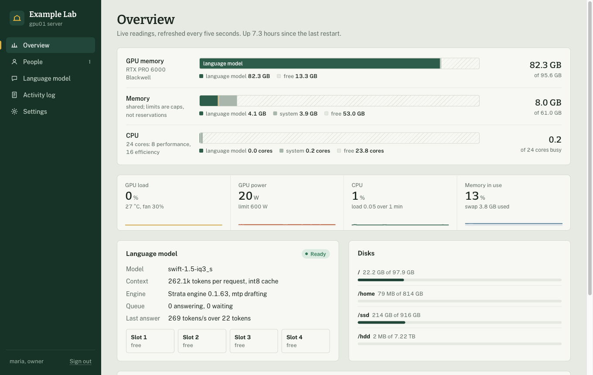
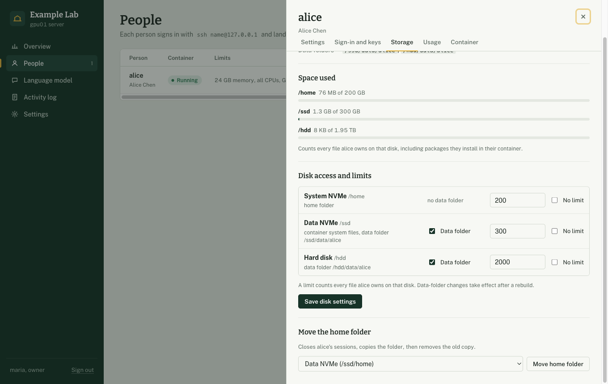
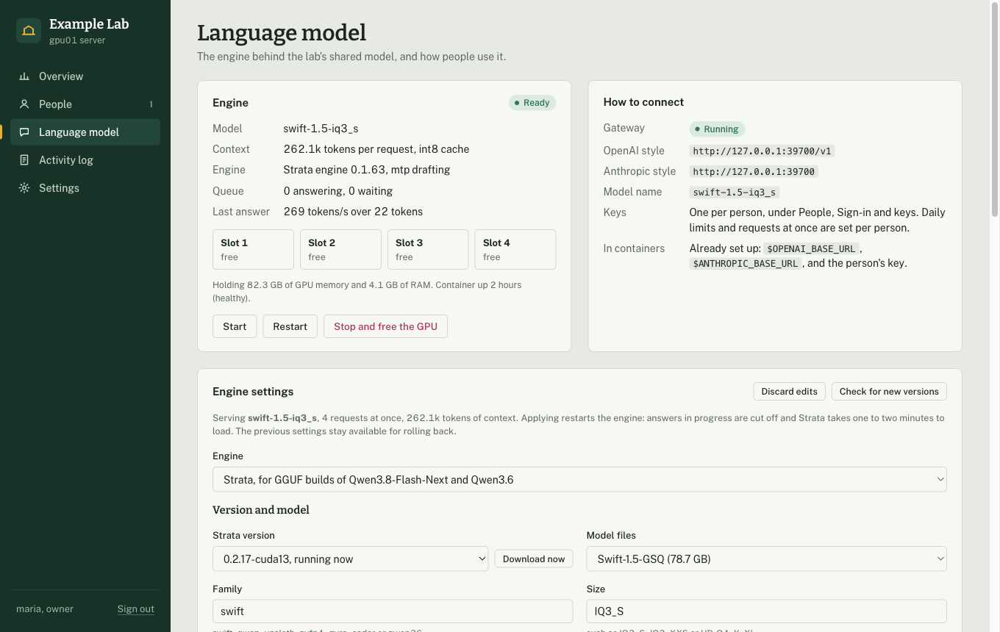
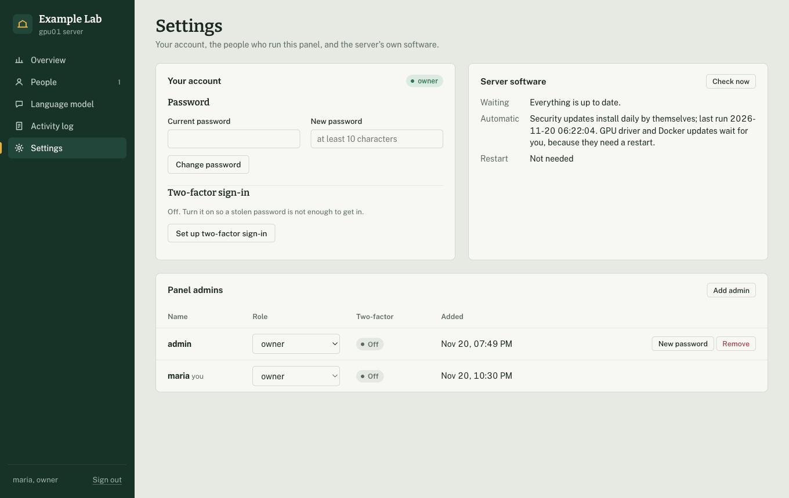

# lab-panel

Share one GPU workstation among a research group without running a cluster.

Each person runs `ssh alice@server` on the normal port and lands in their own container. The container has the GPU, a full CUDA, AI and security toolchain, and their home folder. Each container runs in its own user namespace: people can have `sudo` inside, but root inside is an unprivileged host uid that owns nothing outside. An admin manages people, limits, disks and a local language model from a web panel. People reach the model through a metered, OpenAI- and Anthropic-compatible gateway.

It is built from the Python standard library, Podman, Docker and a few lines of bash. There is no Node build, no database server and no agent to install.



## What it does

**People and containers**
- Add, edit, disable and delete people from the panel or with `lab-ctl`. Each person gets a Linux account, an SSH entry point and a container created at first sign-in.
- Set limits per person: memory cap, CPU time, CPU pinning, GPU on/off, and admin rights inside the container. Limits are ceilings, not reservations: five people can each have a 64 GB cap on a 128 GB machine.
- The container reports its own limits through lxcfs, so `nproc`, `free` and `htop` inside it show what the person actually has.
- Rebuilding a container keeps the person's home and data folders.
- Each container gets its own fixed range of 65,536 host uids, so its root is not the host's root and not any other person. Home and data folders are id-mapped: the person's files keep their real owner on disk, and files made with `sudo` belong to the container's own base uid, so nothing inside can create a file owned by host root.

**Disks**
- Describe your disks once in `/etc/lab/lab.json`. Per person you then choose where the home folder lives, which data disks are mounted, and how much they may fill on each.
- Disk limits are kernel-enforced ext4 user quotas, not periodic scans. Container system files count against the person's limit on the disk that holds Docker's data.

**Language model**
- Start, stop and reconfigure one local inference engine from the panel. Strata is supported out of the box, and there are templates for vLLM, SGLang and llama.cpp. Image upgrades are digest-verified and can be rolled back.
- Every person gets their own API key, a daily token quota and a concurrency cap. Usage is logged per request.
- The gateway speaks OpenAI Chat Completions, OpenAI Responses and Anthropic Messages, so Claude Code, Codex, and OpenAI or Anthropic SDKs work inside the containers with no setup.

**Running the server**
- Live CPU, memory, GPU and disk use, per person and in total.
- GPU accounting per person and per day: hours their programs kept the GPU computing, hours they held GPU memory, and their peak memory.
- An activity log of every change and sign-in.
- Panel admins with roles (owner, admin, viewer) and optional two-factor sign-in (TOTP).
- OS updates from the panel. GPU-driver and Docker updates are held for a planned restart.

| | |
|---|---|
|  |  |
| Per-person disk access and limits | The engine and how people connect |
|  | |
| Admins, two-factor sign-in and updates | |

## How it works

```
 laptop ──ssh──▶ sshd (Match Group labusers, ForceCommand) ──sudo──▶ lab-enter ──podman exec──▶ lab-<name>
 laptop ──https─▶ panel.py :39743  (admins)                                                    │  home, data folders,
 container ─────▶ gateway.py :39700 ──(key, quota, usage)──▶ llm-engine 127.0.0.1:39701         │  GPU, cgroup limits
```

- `lab-enter` is the only thing members may run as root. It creates or starts their container with the limits in `/etc/lab/users/<name>.conf`, then execs their shell, SFTP or command inside it.
- `panel.py` serves the web UI and JSON API over HTTPS (self-signed by default). `lab-ctl` does the same operations from a shell.
- `gateway.py` runs as an unprivileged user. It checks the person's key and quota, forwards the request to the engine, and records token usage in SQLite.
- `engine.py` owns the single engine container: apply settings, roll back, pull versions.

## Requirements

- Ubuntu 22.04 or 24.04 (other systemd distributions are likely to work but are untested).
- Podman 5 (tested with 5.7 and crun 1.21) for people's containers, and Docker 24 or newer for the model engine. `RUNTIME=docker` in `/etc/lab/containers.conf` runs people's containers under Docker instead, without user namespaces.
- For the GPU: NVIDIA driver and `nvidia-container-toolkit` 1.17 or newer.
- Python 3.10 or newer, OpenSSL, OpenSSH server.
- Linux 6.x with ext4 for disks where you want enforced limits (id-mapped mounts need ext4, xfs or btrfs).

## Install

```bash
git clone <this repo> && cd lab-panel
sudo LAB_ORG="Physics Lab" panel/install.sh      # panel, gateway, ssh wiring, first admin (password printed once)
sudoedit /etc/lab/lab.json                        # describe your disks (see lab.example.json), then:
sudo panel/storage-setup.sh                       # turn on per-person disk limits and lxcfs
sudo lab-ctl build                                # build the container image (20-40 minutes)
sudo scripts/harden.sh                            # optional, recommended: firewall, fail2ban, sshd, update policy
sudo scripts/gpu-profiling.sh on                  # optional: GPU performance counters for everyone (after a reboot)
```

Then open `https://<server>:39743`, sign in as `admin`, and add your first person.

Where upstream package sources are slow, copy `devbox/mirrors-cn.args` (or your own `KEY=value` file) to `/etc/lab/devbox.args` before `lab-ctl build`. For engine images, set `hf_endpoint` and `ghcr_mirror` in `lab.json`. Images pulled through a mirror are checked against ghcr.io's digest before use.

## Configuration

Everything host-specific lives in `/etc/lab/lab.json`. Missing keys take the defaults in `panel/labcore.py`.

| Key | Meaning |
|---|---|
| `org` | Name shown in the panel and in the TLS certificate |
| `storage` | Disks people can use: `path` (mount point; limits apply here), `label`, `homes` (where home folders may live), `data` (parent of per-person data folders) |
| `default_quota_gb` | Limits for new people, per disk path |
| `container_fs` | Disk that holds container system files; empty = detect from Docker |
| `default_sudo` | Whether new people get admin rights inside their container |
| `models_root` | Engine model folders must be under this path |
| `hf_endpoint`, `ghcr_mirror` | Optional mirrors for model and engine downloads |

`/etc/lab/containers.conf` holds container defaults: runtime, image, memory cap, shared memory, process limit and folders everyone shares.

## Security model

Read [docs/security.md](docs/security.md) before giving accounts to people you do not trust. In short, each person has their own filesystem view, process namespace, resource limits and host uid range, so root inside a container cannot touch the host or other people. They share the host's network namespace and the GPU. That is the right trade-off for a research group; it is not a multi-tenant hosting boundary.

## Compared with

- **[gpu-platform](https://github.com/vudinhhong/gpu-platform)**, **[MEGREZ](https://github.com/XShengTech/MEGREZ)**: per-user containers reached through Jupyter, or SSH on per-user ports. lab-panel keeps plain `ssh name@server`, enforces disk limits in the kernel, and manages a local LLM with per-person keys and quotas.
- **[Bursar](https://github.com/Samsara-1999/Bursar)**: governance for SSH users on bare hosts, with no containers.
- **JupyterHub with DockerSpawner**, **Coder**: browser-first development environments. They are more general and need more moving parts.
- **Slurm**, **Kubernetes**: the right answer once you have several machines.

## Status

Runs one RTX PRO 6000 workstation for a small lab. Single host by design. Issues and pull requests are welcome.

## License

[Apache License 2.0](LICENSE). The bundled fonts, Bitter and Public Sans, are under the [SIL Open Font License 1.1](panel/static/OFL.txt).
